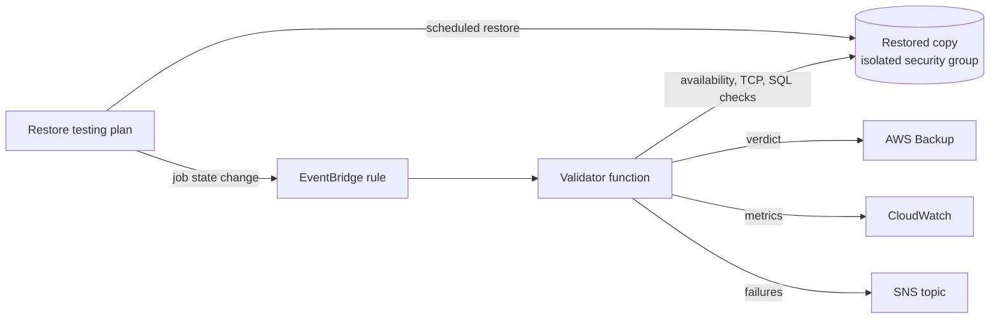

# aws-backup-restore-drill

A scheduled restore drill for RDS databases.

A backup job that reports success proves that bytes were written somewhere. It
does not prove that the database comes back, that the data in it is recent, or
how long the restore takes. This module restores a real recovery point on a
schedule, checks the result and reports it, so those three questions are
answered every week instead of during an incident.

## What it does

1. An AWS Backup restore testing plan restores a recovery point of the selected
   RDS instances on a schedule. By default it takes the latest one.
2. The restored copy lands in its own security group. Nothing can reach it
   except the validator.
3. When the restore job reaches a final state, EventBridge invokes a validator
   function. It checks that the instance is available, that it accepts
   connections, and optionally that your own SQL checks pass.
4. The verdict goes back to AWS Backup, so it shows up next to the restore job
   in the console and in the API.
5. Two CloudWatch metrics are published: `DrillSuccess` and
   `RestoreDurationSeconds`, your measured restore time.
6. With `sns_topic_arn` set, a failed drill is published to SNS. So is a
   restore job that failed, and a validator run that crashed.
7. AWS Backup deletes the restored copy when the validation window closes.



## Status

Version 0.1. The Terraform code is validated and plan-tested in CI against a
mocked AWS provider, and the validator has unit tests. It has not been applied
to a real AWS account yet. Treat the first run in your account as the
integration test, and read the plan before you apply it.

## Usage

```hcl
module "restore_drill" {
  source = "git::https://github.com/krusicb90/terraform-modules.git//modules/aws-backup-restore-drill?ref=<commit or tag>"

  name                    = "orders-restore-drill"
  protected_resource_arns = [aws_db_instance.orders.arn]

  vpc_id                       = module.vpc.vpc_id
  restore_db_subnet_group_name = aws_db_subnet_group.restore_test.name
  validator_subnet_ids         = module.vpc.private_subnets

  db_name                = "orders"
  credentials_secret_arn = aws_secretsmanager_secret.orders_db.arn
  lambda_layer_arns      = [aws_lambda_layer_version.pg8000.arn]

  sql_checks = [
    {
      name      = "orders exist"
      query     = "select count(*) from orders"
      min_value = 1000
    },
    {
      name          = "newest order is recent"
      query         = "select max(created_at) from orders"
      max_age_hours = 50
    },
  ]

  sns_topic_arn = aws_sns_topic.alerts.arn
}
```

A complete configuration is in [examples/rds-postgres](examples/rds-postgres).

Without `sql_checks` the module still proves that the recovery point restores
into an instance that accepts connections, and measures how long that takes.
That needs no credentials and no driver layer.

## Requirements

- The RDS instances are already backed up by AWS Backup. This module tests
  restores. It does not create backups.
- A DB subnet group with private subnets for the restored copy.
- Private subnets for the validator with a route to the AWS APIs, through a
  NAT gateway or VPC endpoints (Backup, RDS, Secrets Manager, CloudWatch, SNS).
- Terraform 1.7 or newer, AWS provider 6.0 or newer.

## SQL checks

Each check is one query. It must return at least one row, and the first column
of the first row is compared with the expectation:

| Field | Meaning |
|-------|---------|
| `name` | Shown in the verdict and in notifications. |
| `query` | The SQL to run. It runs in a read-only session. |
| `min_value` | Fail if the value is a number below this. Use it for row counts. |
| `max_age_hours` | Fail if the value is a timestamp older than this. Use it for the newest row. |

Set `max_age_hours` to your backup interval plus some slack. A daily backup
restored a few hours later is fine at 30. At 12 the drill would fail every time.

SQL checks need a database driver, supplied as a Lambda layer:

```sh
scripts/build-driver-layer.sh postgres   # or: mysql
```

The script prints how to publish the layer. Both drivers are pure Python.

## Design decisions

**A Lambda function, not a container task.** The validation is a few API calls
and a few queries, triggered by an event, a handful of times per drill. A
function costs nothing while idle and needs no cluster. The limit is 15
minutes. Checks that need longer, or need tools such as `pg_restore`, belong in
an ECS task behind the same EventBridge rule.

**The restored copy is isolated.** It is a full copy of production data, so it
gets a security group that accepts the database port from the validator only.
The module sets the subnet group and security group last when it merges
`restore_metadata_overrides`. A caller cannot move the copy somewhere reachable
by accident, and a test proves it.

**No retries, and a failure destination.** A verdict can be set once per
restore job, so a retried invocation would only fail on the second attempt. The
function catches its own errors and reports them as a failed drill. If it
crashes or times out before it can report, Lambda sends the event to the SNS
topic, so a drill does not disappear silently. This needs `sns_topic_arn`.

**A failed restore is reported, not ignored.** The EventBridge rule matches
`FAILED` and `ABORTED` restore jobs as well as `COMPLETED` ones. A restore that
does not complete is the result the drill exists to find.

**The driver comes as a layer.** Vendoring a driver into this repository would
mean shipping someone else's code and updating it by hand. A layer keeps the
module small and lets you pin the driver version yourself.

**TLS is always on, verification is opt-in.** The validator always encrypts the
connection. It verifies the server certificate when you pass the RDS CA bundle
with `db_ca_bundle_file`. Without it the connection is encrypted but not
verified. That is acceptable between two security groups that only talk to each
other, and it is still stated here so that it is a decision and not a surprise.

## Cost

You pay for the restored instance and its storage from the start of the restore
until AWS Backup deletes it after `validation_window_hours`. Use
`restore_instance_class` to restore into a smaller instance class than
production. The function, the metrics and the logs cost cents per month.

## Limitations

- RDS instances only. Aurora clusters restore as clusters and need different
  restore metadata.
- The restored database has the credentials it had when the recovery point was
  taken. If the password was rotated since then, SQL checks fail to log in.
- One account and one region. Cross-account vaults are not handled.
- A check looks at one value: the first column of the first row.

## Inputs

| Name | Description | Type | Default |
|------|-------------|------|---------|
| `name` | Name used as a prefix for every resource. Lowercase letters, digits and hyphens. | `string` | required |
| `protected_resource_arns` | ARNs of the RDS instances to restore-test (up to 30). Use this or protected_resource_tags, not both. | `list(string)` | `[]` |
| `protected_resource_tags` | Select RDS instances by tag instead of by ARN. Every tag must match. Use this or protected_resource_arns, not both. | `map(string)` | `{}` |
| `schedule_expression` | Cron expression for the drill, in AWS Backup format. | `string` | `"cron(0 3 ? * SUN *)"` |
| `schedule_expression_timezone` | Time zone of schedule_expression. | `string` | `"Etc/UTC"` |
| `start_window_hours` | Hours after the scheduled time in which the restore job may start (1-168). | `number` | `1` |
| `recovery_point_algorithm` | Which recovery point to restore: LATEST_WITHIN_WINDOW or RANDOM_WITHIN_WINDOW. | `string` | `"LATEST_WITHIN_WINDOW"` |
| `recovery_point_types` | Recovery point types to consider: SNAPSHOT, CONTINUOUS or both. | `list(string)` | `["SNAPSHOT"]` |
| `selection_window_days` | How far back to look for a recovery point (1-365). Keep it longer than the backup interval, or the drill has nothing to restore. | `number` | `7` |
| `include_vaults` | Backup vault ARNs to take recovery points from. The default takes them from every vault. | `list(string)` | `["*"]` |
| `exclude_vaults` | Backup vault ARNs to skip. | `list(string)` | `[]` |
| `validation_window_hours` | Hours the restored instance is kept for validation before AWS Backup deletes it (1-168). You pay for the instance during this window. | `number` | `1` |
| `vpc_id` | VPC in which the restored instance and the validator run. | `string` | required |
| `restore_db_subnet_group_name` | DB subnet group for the restored instance. Use private subnets. | `string` | required |
| `validator_subnet_ids` | Private subnets for the validator function. They need a route to the AWS APIs (NAT gateway or VPC endpoints). | `list(string)` | required |
| `validator_https_egress_cidrs` | CIDR blocks the validator may reach on port 443 to call AWS APIs. Narrow this to your VPC endpoints if you use them. | `list(string)` | `["0.0.0.0/0"]` |
| `db_port` | Port the database listens on. | `number` | `5432` |
| `restore_instance_class` | Instance class for the restored copy. Leave null to let AWS Backup infer it from the recovery point. | `string` | `null` |
| `restore_metadata_overrides` | Extra restore metadata overrides. The subnet group and security group set by this module always win, so the restored copy stays isolated. | `map(string)` | `{}` |
| `engine` | Database engine, used for sql_checks: postgres or mysql. | `string` | `"postgres"` |
| `db_name` | Database to connect to for sql_checks. | `string` | `""` |
| `credentials_secret_arn` | Secrets Manager secret with the JSON keys username and password, valid for the source database. Required for sql_checks. | `string` | `null` |
| `credentials_kms_key_arn` | KMS key that encrypts the credentials secret, if it is a customer managed key. | `string` | `null` |
| `sql_checks` | Queries to run against the restored database, in a read-only session. Each needs `name` and `query`, and optionally `min_value` or `max_age_hours`. See [SQL checks](#sql-checks). | `list(object)` | `[]` |
| `db_ca_bundle_file` | Path to a PEM file with the RDS certificate authority bundle. When set, the validator verifies the server certificate. When null, the connection is encrypted but not verified. | `string` | `null` |
| `lambda_layer_arns` | Lambda layers for the validator. sql_checks need a layer with pg8000 (postgres) or PyMySQL (mysql). See scripts/build-driver-layer.sh. | `list(string)` | `[]` |
| `validator_timeout_seconds` | Timeout of the validator function. It includes waiting for the restored instance to become available. | `number` | `300` |
| `validator_memory_mb` | Memory of the validator function, in MB. | `number` | `256` |
| `log_retention_days` | Retention of the validator logs, in days. The logs are the record that a drill ran, so the default keeps a year. | `number` | `365` |
| `kms_key_arn` | Customer managed KMS key for the validator's logs and environment variables. Its key policy must allow CloudWatch Logs. Leave null to use AWS managed encryption. | `string` | `null` |
| `sns_topic_arn` | SNS topic for the drill result. Failed drills are always published, and so is a validator run that crashes or times out. Leave null to disable notifications. | `string` | `null` |
| `notify_on_success` | Also publish successful drills to the SNS topic. | `bool` | `false` |
| `metric_namespace` | CloudWatch namespace for the DrillSuccess and RestoreDurationSeconds metrics. | `string` | `"RestoreDrill"` |
| `tags` | Tags added to every resource. | `map(string)` | `{}` |

## Outputs

| Name | Description |
|------|-------------|
| `restore_testing_plan_name` | Name of the restore testing plan. |
| `restore_testing_plan_arn` | ARN of the restore testing plan. |
| `restore_testing_selection_name` | Name of the restore testing selection. |
| `restore_role_arn` | ARN of the role AWS Backup uses to restore. |
| `validator_function_name` | Name of the validator function. |
| `validator_function_arn` | ARN of the validator function. |
| `validator_role_arn` | ARN of the validator function's role. Use it to grant access to a customer managed KMS key. |
| `validator_security_group_id` | Security group of the validator function. |
| `restored_security_group_id` | Security group attached to every restored test instance. |
| `event_rule_arn` | ARN of the EventBridge rule that triggers the validator. |
| `metric_namespace` | CloudWatch namespace of the DrillSuccess and RestoreDurationSeconds metrics. |

## Tests

```sh
terraform init -backend=false && terraform test      # plan tests, mocked provider, no AWS account
cd lambda && pip install boto3 pytest && pytest      # validator unit tests
```
