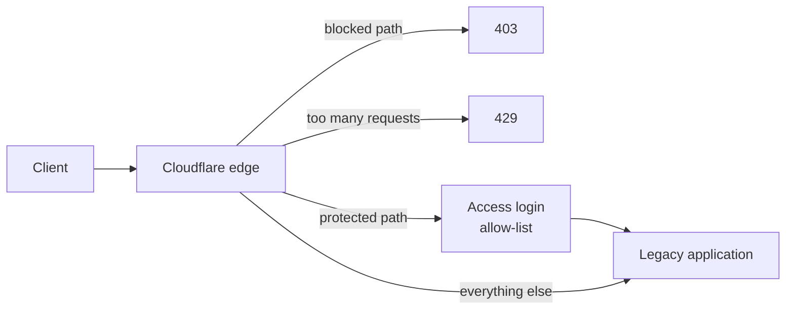

# cloudflare-legacy-app-shield

Protect an application that cannot be patched.

Some applications stay in production long after the last upgrade that was
possible: the vendor moved on, the upgrade is a rewrite, or the budget went
elsewhere. The known vulnerabilities stay too. This module puts the protection
in front of the application, at the Cloudflare edge, without touching the
server.

## What it does

1. **Requires a login for staff areas.** Each path in `protected_paths` gets a
   Cloudflare Access application with an allow-list of emails or email
   domains. The admin area stops being reachable from the internet at large.
2. **Blocks endpoints nobody needs.** Each path in `blocked_paths` is blocked
   for everyone. This is the fix for an endpoint with a known vulnerability
   that the public site does not use.
3. **Rate limits the paths that get hammered**, such as a login page.



## Usage

```hcl
module "shield" {
  source = "git::https://github.com/krusicb90/terraform-modules.git//modules/cloudflare-legacy-app-shield?ref=<commit or tag>"

  account_id = var.cloudflare_account_id
  zone_id    = var.cloudflare_zone_id
  name       = "legacy-cms"
  hostname   = "www.example.com"

  protected_paths       = ["/admin", "/cms/editor"]
  allowed_email_domains = ["example.com"]

  blocked_paths = [
    "/reports/export.ashx",
    "/upload/handler.axd",
  ]

  rate_limit = {
    paths               = ["/login"]
    requests_per_period = 20
  }
}
```

A complete configuration is in [examples/legacy-cms](examples/legacy-cms).

Every part is optional. A module call with only `blocked_paths` creates one
firewall rule and nothing else.

## Requirements

- The application's hostname is proxied through Cloudflare.
- Zero Trust is enabled on the account, if you use `protected_paths`.
- An API token that can edit zone WAF rules, and Access applications and
  policies.
- Terraform 1.7 or newer, Cloudflare provider 5.x.

## Rate limiting

| Field | Meaning |
|-------|---------|
| `paths` | Path prefixes the limit applies to. |
| `requests_per_period` | Requests one client may make per period before it is blocked. |
| `period` | Counting period in seconds. Default 10. |
| `mitigation_timeout` | How long the client stays blocked, in seconds. Default 10. |

The defaults are the values the free plan accepts. Paid plans allow longer
periods and timeouts.

## Design decisions

**Matching ignores case.** Legacy stacks such as IIS serve `/Admin`, `/admin`
and `/ADMIN` as the same page, and an attacker tries all of them. Both the
request path and the configured path are lowered before they are compared. A
rule that matched only the spelling in the documentation would look right and
protect nothing.

**All blocked paths share one rule.** Plans limit the number of custom rules.
One rule with one expression leaves the rest of the allowance free.

**Every rule is scoped to the hostname.** A zone often serves more than one
application. The rules cannot change the behaviour of another hostname in the
same zone.

**Paths are validated before they reach an expression.** A path may contain
letters, digits and a few punctuation characters. A value with a quote or a
bracket in it is rejected at plan time, so it can never change the meaning of
the rule.

**The module owns the zone's custom rules.** Cloudflare allows one custom
firewall ruleset and one rate limiting ruleset per zone. Rules that already
exist in the zone belong in `extra_firewall_rules`, where they sit in the same
ruleset, after the block rule.

**An empty allow-list is an error.** `protected_paths` without identities
would lock everyone out. The module refuses to plan it.

## Scope

- One hostname per module call. Call the module again for another hostname in
  a different zone.
- Blocked and rate limited paths match by prefix: `/admin` also covers
  `/admin/users` and `/administrator`. Protected paths cover the path and
  everything below it.
- Identities are email addresses and email domains.
- Blocking and rate limiting use the block action.

## Inputs

| Name | Description | Type | Default |
|------|-------------|------|---------|
| `account_id` | Cloudflare account ID. | `string` | required |
| `zone_id` | ID of the Cloudflare zone that serves the application. | `string` | required |
| `name` | Name used as a prefix for the rulesets, the Access applications and the policy. | `string` | required |
| `hostname` | Public hostname of the application, proxied through Cloudflare. Every rule is scoped to it. | `string` | required |
| `protected_paths` | Path prefixes that require a login through Cloudflare Access, for example /admin. Use it for the parts only staff should reach. | `list(string)` | `[]` |
| `allowed_emails` | Email addresses that may reach the protected paths. | `list(string)` | `[]` |
| `allowed_email_domains` | Email domains whose users may reach the protected paths, for example example.com. | `list(string)` | `[]` |
| `session_duration` | How long a login stays valid before the user must authenticate again. | `string` | `"8h"` |
| `blocked_paths` | Path prefixes that are blocked for everyone at the Cloudflare edge, for example an endpoint with a known vulnerability that the application does not need. | `list(string)` | `[]` |
| `extra_firewall_rules` | More custom firewall rules for the zone. A zone has one custom ruleset, and this module owns it, so rules that exist outside the module belong here. | `list(object)` | `[]` |
| `rate_limit` | Rate limit for path prefixes such as a login page, counted per client IP. See [Rate limiting](#rate-limiting). | `object` | `null` |

## Outputs

| Name | Description |
|------|-------------|
| `firewall_ruleset_id` | ID of the custom firewall ruleset. Null when there are no blocked paths and no extra rules. |
| `rate_limit_ruleset_id` | ID of the rate limiting ruleset. Null when rate_limit is not set. |
| `blocked_expression` | The expression that matches the blocked paths. Paste it into the Cloudflare dashboard to test it against real traffic. |
| `protected_urls` | The host and path of everything that requires a login. |
| `access_application_ids` | ID of the Access application of each protected path, by path slug. |
| `access_policy_id` | ID of the Access policy shared by the protected paths. Null when there are none. |

## Tests

```sh
terraform init -backend=false && terraform test   # mocked provider, no Cloudflare account
```
