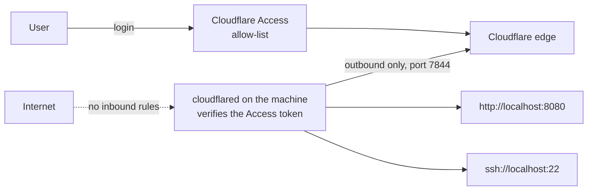

# cloudflare-tunnel-private-access

Reach a server that has no open inbound ports.

A server that accepts connections from the internet has to defend every one of
them: SSH brute force, scanners, the next vulnerability in whatever listens on
443. This module removes the question. The machine opens an outbound tunnel to
Cloudflare, every hostname behind it requires a login that matches an
allow-list, and the firewall can drop all inbound traffic.

The module is cloud-agnostic. It manages the Cloudflare side and hands you the
user data for the machine. The machine itself can be a droplet, an EC2
instance, an Azure VM or a box under a desk.

## What it does

1. Creates a remotely managed Cloudflare Tunnel.
2. Creates one Access application per service, all sharing one allow policy
   built from email addresses and email domains.
3. Routes each hostname to its service on the machine, and answers 404 for
   anything else.
4. Tells cloudflared to verify the Access token itself, so the origin rejects
   a request that did not pass Access.
5. Creates the DNS records, only after the Access applications exist.
6. Outputs cloud-init user data that installs cloudflared and connects the
   machine, plus the `~/.ssh/config` entries for SSH.



## Status

Version 0.1. The Terraform code is validated in CI and tested with plan and
apply runs against a mocked Cloudflare provider. It has not been applied to a
real Cloudflare account yet, and the cloud-init script has not been run on a
real machine. Treat the first run as the integration test.

## Usage

```hcl
module "private_access" {
  source = "git::https://github.com/krusicb90/terraform-modules.git//modules/cloudflare-tunnel-private-access?ref=<commit or tag>"

  account_id = var.cloudflare_account_id
  zone_id    = var.cloudflare_zone_id
  team_name  = "acme"
  name       = "app-server"

  services = {
    web = {
      hostname = "app.example.com"
      service  = "http://localhost:8080"
    }
    ssh = {
      hostname = "ssh.example.com"
      service  = "ssh://localhost:22"
      type     = "ssh"
    }
  }

  allowed_email_domains = ["example.com"]
}

resource "digitalocean_droplet" "app" {
  # ...
  user_data = module.private_access.cloud_init
}
```

A complete configuration, with a firewall that has no inbound rules, is in
[examples/digitalocean-droplet](examples/digitalocean-droplet).

## Requirements

- A Cloudflare account with Zero Trust enabled and a zone for the hostnames.
  The free plan is enough for a small team.
- An API token that can edit Cloudflare Tunnel, Access applications and
  policies, and DNS for the zone.
- A Debian or Ubuntu machine, if you use the `cloud_init` output. Any machine
  that runs cloudflared works with the `tunnel_token` output.
- Outbound access from the machine to Cloudflare on port 7844 (TCP and UDP)
  and to the package repository on 443.
- Terraform 1.7 or newer, Cloudflare provider 5.x.

## Services

| Field | Meaning |
|-------|---------|
| `hostname` | Public hostname. It must be inside the zone. |
| `service` | Where cloudflared sends the traffic: `http://`, `https://`, `ssh://`, `rdp://` or `tcp://`. |
| `type` | Access application type: `self_hosted` (default) or `ssh`. |
| `verify_access_at_origin` | Make cloudflared reject requests without a valid Access token. Default `true`. |

For SSH, install cloudflared on your own computer, add the `ssh_config` output
to `~/.ssh/config` and connect as usual. The first connection opens a browser
for the login.

## Design decisions

**Two locks, not one.** Access in front of the hostname is the first lock. The
second is on the machine: cloudflared validates the Access token of every
request against the application it was issued for. If someone deletes an
Access application in the dashboard, or points another hostname at the tunnel,
the origin still refuses the request. A test checks that each service accepts
tokens for its own application and no other.

**DNS comes last.** The DNS records depend on the Access applications. A
hostname never resolves to the tunnel before something protects it.

**An empty allow-list is an error.** A policy without identities would lock
everyone out, and the usual fix for that is a hurried "allow everyone". The
module refuses to plan without at least one email or email domain.

**The tunnel is remotely managed.** The routing lives in Cloudflare, managed by
Terraform. The machine holds one token. There is no config file on the server
to drift, and replacing the server does not change the tunnel.

**Unknown hostnames get a 404.** The last ingress rule answers 404, so a
hostname that someone points at the tunnel by hand reaches nothing.

**The module does not create the machine.** Creating a VM is a different
decision for every cloud and every team. Returning user data keeps the module
small and usable everywhere.

## The tunnel token

The `cloud_init` output contains the tunnel token, and most clouds let any
process on the machine read user data from the metadata service. Anyone with
the token can run a second connector for this tunnel. That is acceptable when
you already trust what runs on the machine. If you do not, pass
`tunnel_token` through your secret store instead and install cloudflared
yourself. The simplest way to rotate the token is to replace the tunnel.

Both outputs are marked sensitive, but they are stored in the Terraform state.
Protect the state accordingly.

## Limitations

- Identities are email addresses and email domains. Identity provider groups
  are not supported yet.
- SSH needs cloudflared on the client. Browser-rendered SSH is not configured.
- Origin verification is on for every service type by default. It is
  documented by Cloudflare for HTTP services. If an SSH or TCP service does not
  connect, set `verify_access_at_origin = false` for that service. Access in
  front of the hostname stays in place.
- All hostnames must be in one zone.
- The `cloud_init` output targets Debian and Ubuntu.

## Inputs

| Name | Description | Type | Default |
|------|-------------|------|---------|
| `account_id` | Cloudflare account ID. | `string` | required |
| `zone_id` | ID of the Cloudflare zone that holds the hostnames. | `string` | required |
| `team_name` | Zero Trust team name: the first part of `<team>.cloudflareaccess.com`. cloudflared uses it to verify Access tokens at the origin. | `string` | required |
| `name` | Name of the tunnel, also used as a prefix for the Access applications and the policy. | `string` | required |
| `services` | Services on the machine to publish through the tunnel, keyed by a short name. See [Services](#services). | `map(object)` | required |
| `allowed_emails` | Email addresses that may reach the services. | `list(string)` | `[]` |
| `allowed_email_domains` | Email domains whose users may reach the services, for example example.com. | `list(string)` | `[]` |
| `session_duration` | How long a login stays valid before the user must authenticate again. | `string` | `"8h"` |

## Outputs

| Name | Description |
|------|-------------|
| `tunnel_id` | ID of the tunnel. |
| `tunnel_token` | Token that cloudflared uses to connect the machine to the tunnel. Treat it as a secret. |
| `cloud_init` | cloud-config user data that installs cloudflared on a Debian or Ubuntu machine and connects it to the tunnel. It contains the tunnel token. |
| `hostnames` | Public hostname of each service, by service key. |
| `access_application_ids` | ID of the Access application of each service, by service key. |
| `access_policy_id` | ID of the Access policy shared by every service. |
| `ssh_config` | Entries for ~/.ssh/config that route SSH to the ssh-type services through cloudflared. Empty when there are none. |

## Tests

```sh
terraform init -backend=false && terraform test   # mocked provider, no Cloudflare account
```
